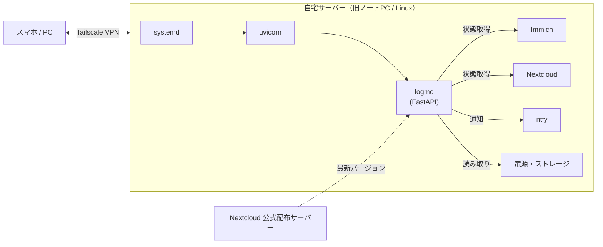

<p align="center">
  
</p>

# logmo

**自宅サーバーの「異常に気づけない」を解決する、監視 Web アプリ**

使わなくなったノートPCで自宅サーバー（Nextcloud・Immich）を構築・運用する中で、電源が抜けたり、ストレージ容量が逼迫したりしても気づけないという課題がありました。logmo はサーバーの状態を常時監視し、異常があればスマホに通知します。

- 開発期間：約3か月（大学2年次、個人開発）
- 担当：設計・実装・デプロイ・運用（すべて1人）

<!-- スクリーンショットを static/screenshot.png に置くと表示されます -->
<!--  -->

---

## 背景

| 困りごと | 内容 |
|---|---|
| 写真のバックアップ | Googleフォトでバックアップできない状況になり、自分のサーバー（Immich）に移行した |
| 家族のデータ | 父が会社のクラウドに保存していたプライベートなデータを、自分のサーバー（Nextcloud）に移行した |
| 異常に気づけない | 電源プラグが抜けても、ストレージ容量が逼迫しても、気づく手段がなかった |

家族のデータも預かる以上、「止まっていた・壊れていたことに後から気づく」状態をなくしたいと考え、logmo を作りました。

## 主な機能

| 監視項目 | 方法 | 通知のタイミング |
|---|---|---|
| 電源（AC）の接続 | `/sys/class/power_supply/AC/online` を60秒ごとに確認 | 接続→切断に変わったとき |
| ストレージ使用率 | `shutil.disk_usage` を60秒ごとに確認 | 90%以上になったとき（下回るまで再通知しない） |
| Immich のバージョン | Immich の API で現在／最新バージョンを取得（5分ごと） | 更新が見つかったとき1回だけ |
| Nextcloud のバージョン | `status.php` と公式配布サーバーから取得（1時間ごと） | 更新が見つかったとき1回だけ |

- 通知はセルフホストの **ntfy** でスマホに送ります
- Web 画面では、WebSocket で状態を一覧表示します

## システム構成



- **ポート開放はしていません。** 外部からのアクセスはすべて Tailscale のプライベートネットワーク経由です
- systemd で常時起動し、落ちても自動で再起動します（`Restart=always`）

## 技術スタック

| 分類 | 使用技術 |
|---|---|
| バックエンド | Python / FastAPI / uvicorn / httpx（非同期） |
| フロントエンド | HTML / CSS / JavaScript（WebSocket） |
| 通知 | ntfy（セルフホスト） |
| ネットワーク | Tailscale |
| 運用 | systemd / journald |
| 監視対象 | Nextcloud / Immich |

## 工夫したこと

### 1. ポートを開けずに安全に使える構成にした
セキュリティの知識がまだ少なく、ほぼ放置で動かすサーバーのポートを開放するのはリスクだと判断しました。Tailscale を使い、自分の端末からだけアクセスできる構成にしています。その際、Nextcloud の Google ログインのリダイレクト先や、VS Code のリモート接続先も Tailscale 側のアドレスにそろえる必要があり、ネットワーク構成を一つずつ確認しながら設定しました。

### 2. ブラウザを開いていなくても通知が届くようにした
最初は通知処理が WebSocket のループ内にあり、「通知が来るときと来ないときがある」状態でした。「ブラウザが接続している間しか動いていないのでは」と仮説を立てて調べ、FastAPI の `lifespan` でサーバー起動時に監視処理を始める形に変更しました。接続の有無に関係なく通知が届くようになりました。

### 3. 外部への問い合わせを増やさない設計にした
バージョン情報は取得結果をアプリ内にキャッシュして使い回しています。ブラウザのタブを増やしても外部への問い合わせは増えません。取得の間隔は、ローカルの Immich は5分、外部の配布サーバーを見る Nextcloud は1時間と分けています。取得に失敗した場合は前回の値を残し、エラーを表示します。

### 4. 同じ通知を何度も送らない
状態が「正常→異常」に変わったときだけ通知し、異常が続いても通知が鳴り続けないようにしています。

### 5. 毎日使いたくなる見た目にした
名前は「ログモニター」を略して親しみやすく「logmo」に。アイコンは厳しく見張るイメージのカラスです。配色や画面の見やすさにもこだわりました。

## 成果

- logmo の通知で、Nextcloud の動画キャッシュがたまりすぎてストレージが逼迫していることに気づけました。キャッシュを削除して解消し、対象のディレクトリをメモに残しています
- 家族のデータを預かるサーバーを、異常に気づける状態で運用できています

## 学んだこと

- Linux の入門書から始め、サーバー・ネットワーク・プロセス管理（systemd）を実際に動かしながら学びました
- 開発では AI も活用しました。システム構成をメモ（`memo.md`）にまとめて読ませ、エラーの際は自分の仮説とコードを添えて相談する形で進めました

---

## セットアップ

### 環境変数

| 変数名 | 既定値 | 説明 |
|---|---|---|
| `IMMICH_URL` | `http://localhost:2283` | Immich の URL |
| `NEXTCLOUD_URL` | `http://localhost` | Nextcloud の URL |
| `IMMICH_API_KEY` | （必須） | `server.versionCheck` 権限だけを付けた Immich の API キー |

キーは `.env`（`.gitignore` 済み、`chmod 600`）に書き、systemd から読み込ませます。

### systemd ユニット（`/etc/systemd/system/logmo.service`）

```ini
[Unit]
Description=logmo
After=network.target

[Service]
User=sogo
WorkingDirectory=/home/sogo/logmo
ExecStart=/home/sogo/logmo/venv/bin/uvicorn main:app --host 0.0.0.0
EnvironmentFile=/home/sogo/logmo/.env
Restart=always

[Install]
WantedBy=multi-user.target
```

```bash
sudo systemctl daemon-reload
sudo systemctl enable --now logmo
sudo journalctl -u logmo -f   # ログ確認
```

### アクセス

```
http://<TailscaleのIP>:8000
```
